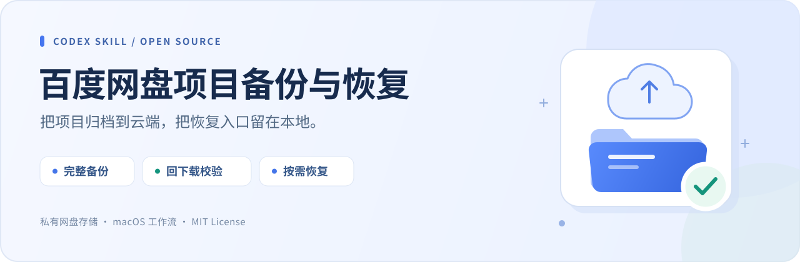
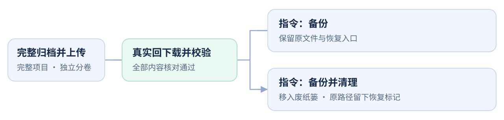

<p align="center">
  
</p>

<h1 align="center">百度网盘项目备份与恢复</h1>

<p align="center">
  对 Codex 说一句话，备份项目、验证内容，并为以后恢复留下入口。
</p>

<p align="center">
  <a href="https://github.com/Datoubaobao/baidu-project-backup/actions/workflows/test.yml"></a>
  <a href="LICENSE"></a>
  <a href="https://github.com/Datoubaobao/baidu-project-backup/releases"></a>
  
  
</p>

<p align="center">
  <a href="#安装">在 Codex 中安装</a> ·
  <a href="docs/STUDENT_QUICKSTART.md">学生三步上手</a> ·
  <a href="docs/USER_GUIDE.md">完整使用手册</a> ·
  <a href="https://github.com/Datoubaobao/baidu-project-backup/releases/latest">下载发布版</a>
</p>

---

## 让项目暂时离开电脑，也能找得回来

课程作业、代码实验和视频素材完成后，常常还需要保留整个项目。这个技能把当前项目完整归档到自己的百度网盘，**实际回下载并校验所有文件**，再按你的要求保留或清理本地文件。

| 完整保存 | 验证后清理 | 按需找回 |
| :--- | :--- | :--- |
| 包含隐藏文件、Git 历史、素材、产物和依赖，不按 `.gitignore` 排除。 | 只有明确要求“备份并清理”，且全部检查通过，才移入废纸篓。 | 可恢复整个项目，也可只下载某个文件涉及的分卷。 |

> [!NOTE]
> **“备份”保留源文件，“备份并清理”才移入废纸篓。** 本技能不自动清空废纸篓，移动本身不释放磁盘空间。

## 安装

### ① 复制这段话，发给 Codex

适用于本地 Codex。使用内置 `$skill-installer` 安装；课堂建议固定使用已发布的 `v0.1.0`：

```text
使用 $skill-installer 安装以下 GitHub 技能：
https://github.com/Datoubaobao/baidu-project-backup
版本：v0.1.0；技能位于仓库根目录（path: .）。
安装名称：baidu-project-backup。只安装，不执行备份或清理。
```

### ② 等待安装完成，再发一条消息检查

```text
请确认你能找到 baidu-project-backup 技能，并简要说明它的用途。现在不要执行备份或清理。
```

Codex 会自动发现新技能；如果仍未识别，重启 Codex 后再试。公开仓库的下载通常不需要登录 GitHub。安装方式与发现机制见 [OpenAI 官方技能文档](https://learn.chatgpt.com/docs/build-skills#install-curated-skills-for-local-use)。

### ③ 打开要备份的项目，先做一次普通备份

```text
使用 $baidu-project-backup 将当前项目备份到我的百度网盘，保留本地文件。
```

**第一次建议使用无敏感信息的小测试项目。** 学生可直接阅读 [三步上手指引](docs/STUDENT_QUICKSTART.md)；完整步骤和问题排查见 [用户使用手册](docs/USER_GUIDE.md)。

<details>
<summary>更习惯手动安装？展开查看</summary>

安装到个人技能目录，已有同名目录时先检查，避免覆盖：

```bash
mkdir -p "$HOME/.agents/skills"
git clone --branch v0.1.0 --depth 1 \
  https://github.com/Datoubaobao/baidu-project-backup.git \
  "$HOME/.agents/skills/baidu-project-backup"
```

个人技能目录和配置差异见 [官方文档](https://learn.chatgpt.com/docs/build-skills)。内置安装器使用当前环境配置的技能目录，无需学生手动指定。不要在多个技能目录重复安装同名版本。

</details>

## 四句话，覆盖常用操作

| 你想做什么 | 在对应项目中发送 |
| :--- | :--- |
| **只备份** | `使用 $baidu-project-backup 备份当前项目，保留本地文件。` |
| **备份并清理** | `使用 $baidu-project-backup 备份并清理当前项目。` |
| **恢复完整项目** | `使用 $baidu-project-backup 恢复这个项目，并继续在原路径工作。` |
| **找回一个文件** | `使用 $baidu-project-backup 恢复 output/report.pdf，放到新的恢复目录。` |

## 备份如何走到可以恢复



默认每卷上限 **2 GiB**，记录 SHA-256、权限、纳秒修改时间、扩展属性及符号链接。清理后，原项目位置留下 `AGENTS.md`、`.codex-baidu-backup.json` 和 `百度网盘恢复说明.md`，供下次定位和恢复。

## 开始前准备好

| 项目 | 要求 |
| :--- | :--- |
| **运行环境** | 本地 Codex，能读写项目并运行 Python 3.10+；脚本只使用标准库。 |
| **百度网盘** | 自己的账号和官方客户端，或已有可信的上传/下载连接器。登录在官方界面完成。 |
| **自动与手动传输** | 自动操作需要桌面控制工具；环境没有该能力时，可手动上传、回下载，再由助手校验。 |
| **磁盘空间** | 暂存与回下载通常至少需要项目体积约两倍的额外空间及余量，也可用外置盘。 |

完整客户端流程面向 **macOS**。Linux 的本地归档测试已覆盖，桌面流程未验证；Windows 不在当前支持范围。技能不自带网盘连接器或桌面控制工具。

## 隐私与使用边界

> [!IMPORTANT]
> **分卷不加密，也不自动脱敏。** 完整备份可能包含 `.env`、Git 历史、配置、密钥及扩展属性；索引和备份信息也记录本机路径。请只上传到自己的私有网盘，不要公开真实分卷、清单、索引或恢复标记。

- 符号链接只保存链接本身，不打包目录外目标；根 `.git` 为 linked worktree 指针时会拒绝归档。
- 特殊设备、套接字、FIFO 会中止操作；硬链接按独立文件保存。ACL、文件所有者、跨平台文件系统语义和服务端聊天记录不在还原承诺范围内。
- 校验脚本验证内容完整性；远端来源需由真实上传和回下载证明。本地复制不能代替云端回下载。

## 文档与贡献

| 从这里开始 | 内容 |
| :--- | :--- |
| [学生三步上手](docs/STUDENT_QUICKSTART.md) | 复制安装、检查技能、完成第一次备份，也包含教师转发文案。 |
| [完整使用手册](docs/USER_GUIDE.md) | 手动传输、清理与恢复、参数、索引和常见问题。 |
| [技能指令](SKILL.md) · [客户端参考](references/baidu-client.md) | Codex 执行流程与官方客户端操作原则。 |
| [贡献说明](CONTRIBUTING.md) · [安全说明](SECURITY.md) | 合成数据测试、问题报告和隐私要求。 |

开发自测：`python3 -B scripts/test_backup.py`。测试仅使用临时合成数据，不访问真实网盘。

---

<p align="center">
  <a href="LICENSE">MIT 开源</a> · 独立开发，与百度及 OpenAI 无隶属关系。
</p>
